<!-- README baseado no template da disciplina (Prof. Dr. João Paulo Aramuni) -->

---

# 🚗 Rodar · Sistema de Aluguel de Carros 👨‍💻

> [!NOTE]
> Sistema web de aluguel de automóveis que conecta **clientes**, **locadoras** e **bancos**: a locadora oferece o veículo com valor diário fixo, o cliente vê o **valor total na hora** e escolhe pagar por conta própria ou pedir **crédito a um banco**, que define a taxa de juros diária e aprova ou recusa o pedido.

<table>
  <tr>
    <td width="800px">
      <div align="justify">
        Projeto do <b>Laboratório 02</b> da disciplina <i>Desenvolvimento e Integração de Aplicações Web (DIAW)</i>, do curso de Engenharia de Software da PUC Minas. O sistema apoia a gestão de aluguéis de automóveis com <b>três hubs independentes</b>: o <b>cliente</b> solicita e acompanha locações; a <b>locadora</b> cadastra veículos e publica ofertas de locação; o <b>banco</b> analisa pedidos de crédito com os dados financeiros do cliente. A aplicação segue a arquitetura <b>MVC</b>, com back-end em <b>Spring Boot</b>, front-end em <b>React + Vite</b> e banco de dados <b>PostgreSQL no Supabase</b>, com login obrigatório via <b>JWT</b>.
      </div>
    </td>
    <td>
      <div>
        
      </div>
    </td>
  </tr>
</table>

---

## 🚧 Status do Projeto

[](#)


---

## 📚 Índice
- [Links Úteis](#-links-úteis)
- [Sobre o Projeto](#-sobre-o-projeto)
- [Funcionalidades Principais](#-funcionalidades-principais)
- [Tecnologias Utilizadas](#-tecnologias-utilizadas)
- [Arquitetura](#-arquitetura)
  - [Diagramas](#diagramas)
- [Instalação e Execução](#-instalação-e-execução)
  - [Pré-requisitos](#pré-requisitos)
  - [Variáveis de Ambiente](#-variáveis-de-ambiente)
  - [Instalação de Dependências](#-instalação-de-dependências)
  - [Inicialização do Banco de Dados (Supabase)](#-inicialização-do-banco-de-dados-supabase)
  - [Como Executar a Aplicação](#-como-executar-a-aplicação)
- [Deploy](#-deploy)
- [Estrutura de Pastas](#-estrutura-de-pastas)
- [Demonstração](#-demonstração)
- [Documentação Utilizada](#-documentação-utilizada)
- [Autores](#-autores)
- [Agradecimentos](#-agradecimentos)
- [Licença](#-licença)

---

## 🔗 Links Úteis

> 📚 Personas, histórias de usuário, casos de uso, fluxos, diagrama de classes, pacotes e modelo de dados.
* 🖼️ **Prints dos diagramas:** [`docs/prints/`](docs/prints/)
* 🎥 **Telas da aplicação:** [`docs/telas/`](docs/telas/)

---

## 📝 Sobre o Projeto

Locadoras de veículos precisam divulgar sua frota e controlar reservas, clientes querem saber quanto vão pagar antes de fechar o aluguel e, muitas vezes, precisam financiar o valor. Esses três lados costumam usar canais separados (planilhas, telefone, e-mail), o que gera reservas sobrepostas e respostas demoradas.

O sistema reúne o processo em um só lugar:
- a **locadora** cadastra veículos e define um **valor fixo diário** para cada um;
- o **cliente** escolhe a oferta, informa apenas as datas e vê o **total calculado na hora** (dias x valor diário), sem risco de reservar um veículo já ocupado;
- se o cliente preferir financiar, o **banco** escolhido recebe o pedido com o valor e os dados do cliente
(incluindo rendimentos), define uma **taxa de juros diária** e concede ou recusa o crédito.

---

## ✨ Funcionalidades Principais

- 🔐 **Autenticação segura:** login obrigatório com usuário e senha (BCrypt + JWT); cada perfil vai para o seu hub.
- 🧾 **Dois tipos de cadastro:** cliente (RG, CPF, endereço, profissão e até 3 rendimentos) e empresa (locadora ou banco).
- 🏢 **Hub da locadora:** CRUD de veículos (proprietário pode ser a locadora, um banco ou um cliente), ofertas de locação com valor fixo diário, consulta das locações feitas.
- 🚘 **Hub do cliente:** ofertas disponíveis, cálculo do total na hora, pagamento próprio (conclusão imediata) ou pedido de crédito, modificação de datas e cancelamento.
- 🏦 **Hub do banco:** pedidos de crédito com valor e dados do cliente, definição da **taxa de juros diária** com prévia do total (juros simples), aprovação ou recusa com motivo.
- 📅 **Sem reservas sobrepostas:** o sistema bloqueia períodos que conflitem com outra locação do mesmo veículo.
- 🔄 **Após recusa:** o cliente decide entre pagar por conta própria, pedir a outro banco ou cancelar.
- ⚙️ **CRUD de cliente:** consultar, alterar e excluir o próprio cadastro.

---

## 🛠 Tecnologias Utilizadas

### 💻 Front-end

* **Biblioteca:** React 19
* **Linguagem:** JavaScript (ES2022+, JSX)
* **Roteamento:** React Router 7
* **Estilização:** CSS próprio com tokens do design system "Asfalto & Âmbar" (fontes Sora e Inter)
* **Estado:** Context API (sessão do usuário)
* **Build:** Vite 8

### 🖥️ Back-end

* **Linguagem:** Java 25 (JDK)
* **Framework:** Spring Boot 4.0 (Spring MVC, Spring Data JPA, Bean Validation)
* **Banco de dados:** PostgreSQL (Supabase)
* **ORM:** Hibernate / JPA (herança JOINED)
* **Autenticação:** Spring Security + OAuth2 Resource Server (JWT HS256) + BCrypt
* **Build:** Apache Maven

### ⚙️ Infraestrutura

* **Banco em nuvem:** Supabase

---

## 🏗 Arquitetura

O sistema segue a arquitetura **MVC**, dividida em dois subsistemas:

1. **Gestão de pedidos e contratos (back-end Spring Boot):** contém o **Model** (entidades JPA, repositórios e serviços com as regras de negócio) e os **Controllers** REST.
2. **Construção dinâmica das páginas web (front-end React + Vite):** é a **View**, que consome a API com o token JWT.

**Fluxo de uma requisição:** tela React → `fetch` com `Authorization: Bearer <token>` → Controller → Service (regras) → Repository (JPA) → PostgreSQL no Supabase, e o caminho de volta com um DTO em JSON.

**Padrões adotados**
- **Repository** (Spring Data JPA) e **Service Layer** para isolar regras de negócio.
- **DTOs** (records Java) com validação na borda da API; a senha nunca sai em uma resposta.
- **Tratamento global de erros** (`@RestControllerAdvice`) com mensagens em português.
- **Herança JOINED:** `Usuario` → `Cliente` e `Agente`; `Agente` → `Locadora` e `Banco`, com uma tabela por classe.
- **Controle de acesso por perfil** com `@PreAuthorize` (ROLE_CLIENTE, ROLE_LOCADORA, ROLE_BANCO) e verificação de dono do recurso nos serviços.

**Decisões importantes**
- O schema do banco é criado por **scripts SQL** (`database/`), nunca pelo Hibernate (`ddl-auto=none`).
- O valor diário é **congelado no pedido**: mudar o preço da oferta não altera locações já feitas.
- Juros simples: `total = valor x (1 + taxa/100 x dias)`, calculado no back-end e exibido como prévia no front-end.

### Diagramas

| Casos de Uso | Diagrama de Classes |
| :---: | :---: |
| 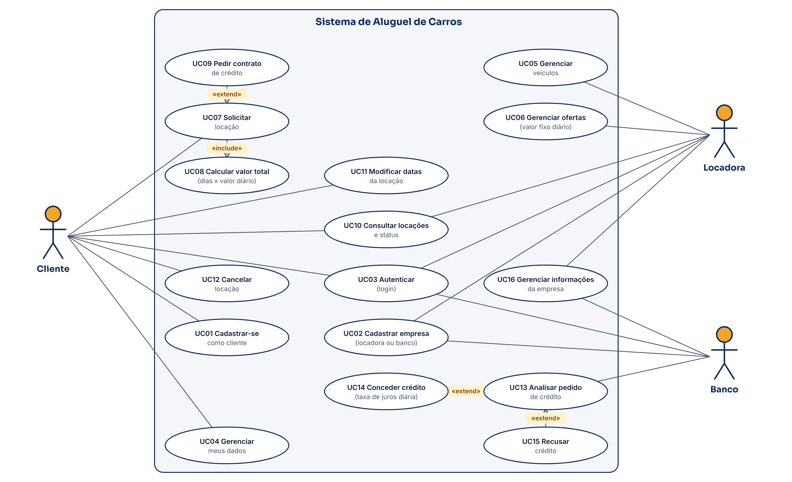 | 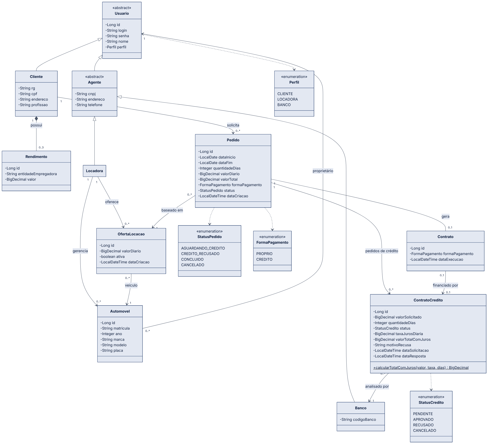 |
| **Diagrama de Pacotes** | **Fluxo da Locação** |
| 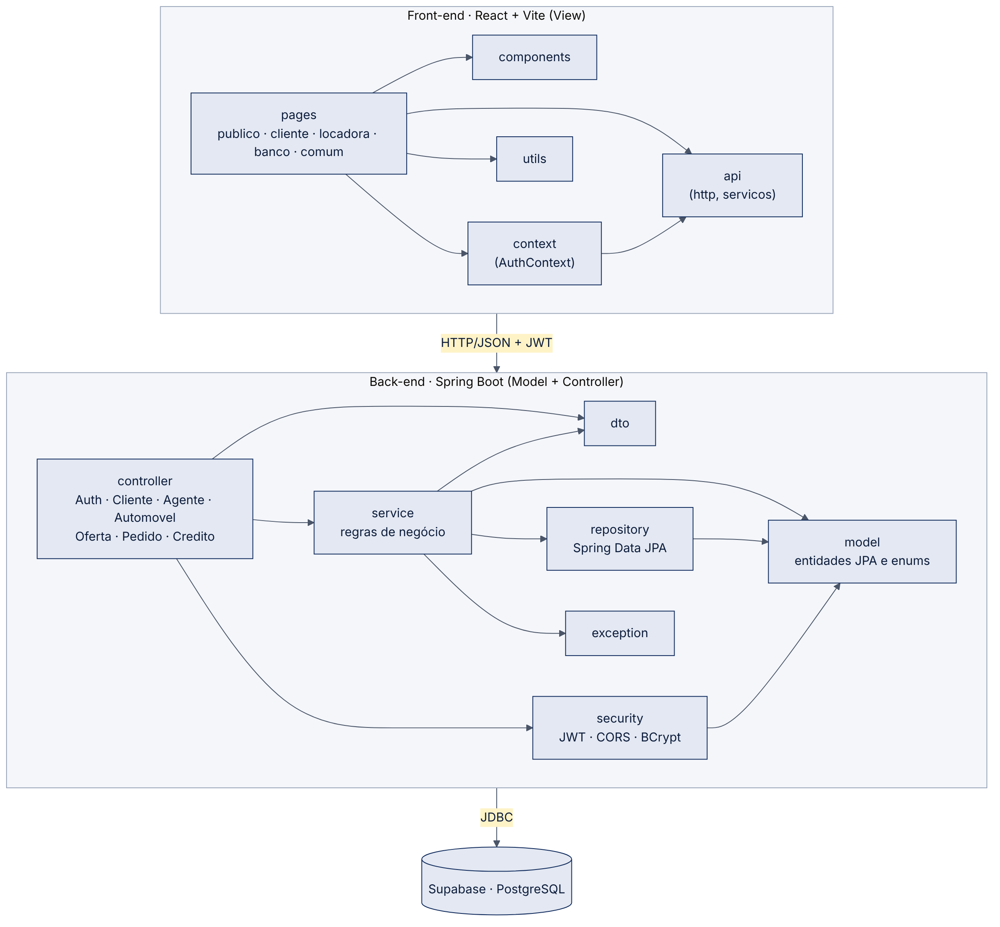 | 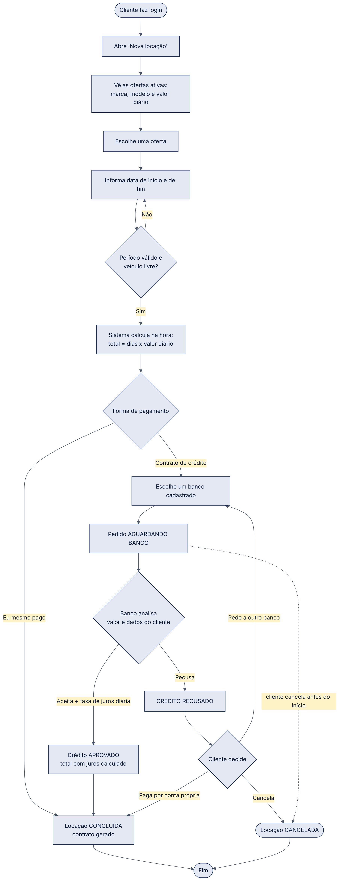 |
| **Estados do Pedido** | **Sequência do Crédito** |
| 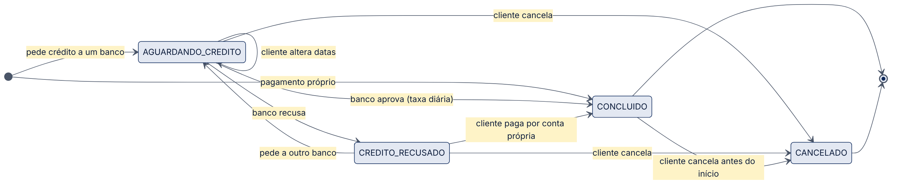 | 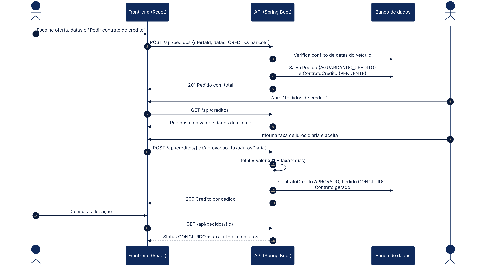 |
| **Modelo de Dados** | **Histórias de Usuário e Personas** |
| 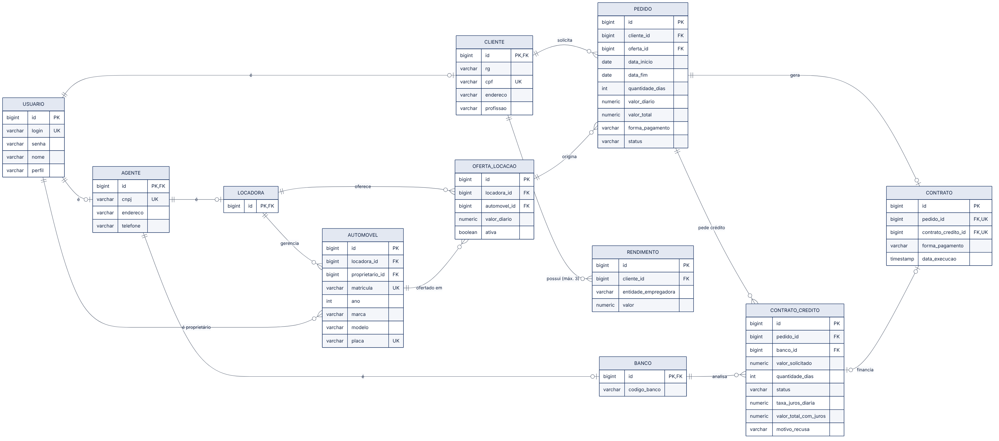 | 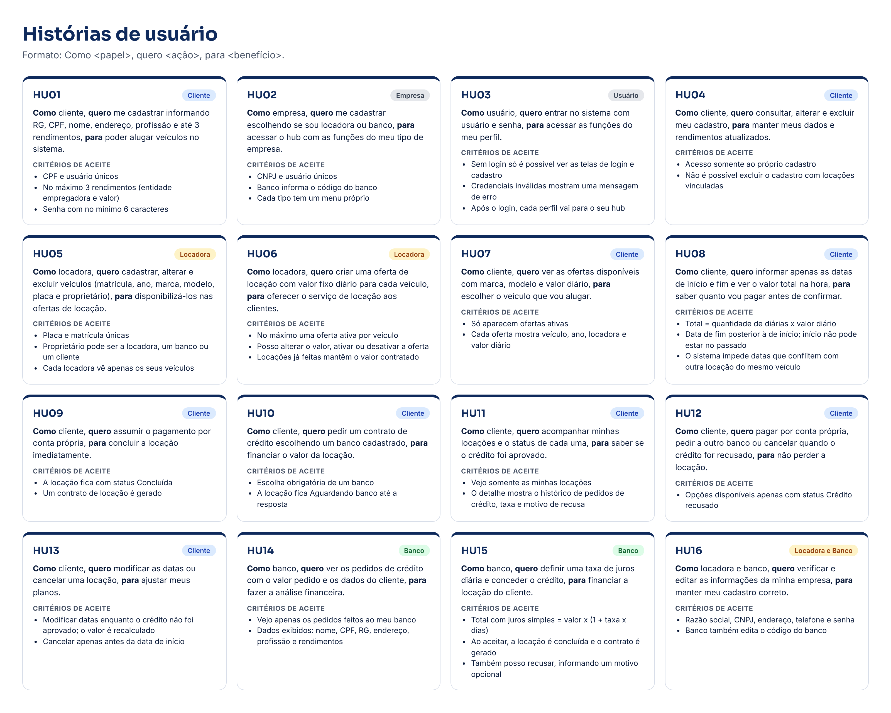 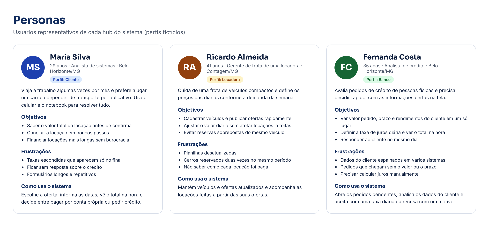 |

> Os arquivos-fonte dos diagramas (Mermaid e scripts) estão em [`docs/fontes-diagramas/`](docs/fontes-diagramas/).

---

## 🔧 Instalação e Execução

### Pré-requisitos

* **Java JDK 25** (confira com `java -version`)
* **Apache Maven 3.9+** usando o JDK 25 (confira com `mvn -v`)
* **Node.js 22+** e **npm**
* **Conta no Supabase** (plano gratuito)

---

### 🔑 Variáveis de Ambiente

#### 1. Back-end (Spring Boot)

Copie `backend/.env.example` para `backend/.env` e preencha. O `application.properties` lê esse arquivo automaticamente (ele está no `.gitignore`).

| Variável | Descrição | Exemplo |
| :--- | :--- | :--- |
| `SUPABASE_DB_URL` | URL JDBC do **Session pooler** do Supabase (porta 5432). | `jdbc:postgresql://aws-0-sa-east-1.pooler.supabase.com:5432/postgres` |
| `SUPABASE_DB_USER` | Usuário do pooler, no formato `postgres.<ref>`. | `postgres.abcdefghij` |
| `SUPABASE_DB_PASSWORD` | Senha do banco definida ao criar o projeto. | `senha-do-banco` |
| `JWT_SECRET` | Segredo do token, com **no mínimo 32 caracteres**. | gerado com `openssl rand -base64 48` |
| `CORS_ORIGENS` | Origem(ns) do front-end. | `http://localhost:5173` |

#### 2. Front-end (React, Vite)

Só é necessário se o back-end não estiver em `http://localhost:8080`. Crie `frontend/.env`:

| Variável | Descrição | Exemplo |
| :--- | :--- | :--- |
| `VITE_API_URL` | URL base do back-end (sem `/api`). | `http://localhost:8080` |

---

### 📦 Instalação de Dependências

```bash
git clone <URL_DO_REPOSITÓRIO>
cd aluguel-carros
```

#### Front-end (React)

```bash
cd frontend
npm install
cd ..
```

#### Back-end (Spring Boot)

```bash
cd backend
mvn clean install
cd ..
```

---

### 💾 Inicialização do Banco de Dados (Supabase)

1. Crie um projeto no Supabase e anote a senha do banco.
2. Abra **SQL Editor → New query** e execute, nesta ordem:
   - `database/01_schema.sql` (cria as tabelas; **atenção:** apaga as tabelas do projeto, se já existirem);
   - `database/02_seed.sql` (cria uma locadora, um banco, três veículos e três ofertas de exemplo).
3. Clique em **Connect**, escolha **Session pooler** e copie host, usuário e senha para o `backend/.env`.

> [!IMPORTANT]
> **Já tinha o banco da versão 1?** (erro `relation "locadora" does not exist`) Em vez dos passos acima, execute apenas `database/03_migracao_v1_para_v2.sql`: ele converte o banco para a versão 2 **mantendo os clientes, empresas, bancos e veículos** (pedidos antigos são descartados). O usuário `empresa` / `Empresa@123` passa a ser uma locadora.

**Contas de desenvolvimento criadas pelo `02_seed.sql`:**

| Perfil | Usuário | Senha |
| :--- | :--- | :--- |
| Locadora | `locadora` | `Locadora@123` |
| Banco | `banco` | `Banco@123` |
| Cliente | crie pela tela **Cadastre-se** | - |

---

### ⚡ Como Executar a Aplicação

Execute em **dois terminais**.

#### Terminal 1: Back-end (Spring Boot)

```bash
cd backend
mvn spring-boot:run
```
🚀 *O back-end fica disponível em **http://localhost:8080**.*

#### Terminal 2: Front-end (React, Vite)

```bash
cd frontend
npm run dev
```
🎨 *O front-end fica disponível em **http://localhost:5173**.*

---

## 🚀 Deploy

1. **Build:**

```bash
cd frontend && npm run build          # gera frontend/dist
cd ../backend && mvn clean package    # gera backend/target/aluguel-carros-0.0.1-SNAPSHOT.jar
```

2. **Configuração:** defina no provedor as variáveis do back-end (`SUPABASE_DB_*`, `JWT_SECRET`, `CORS_ORIGENS` com a URL pública do front-end) e `VITE_API_URL` no build do front-end.

3. **Execução:**

```bash
java -jar backend/target/aluguel-carros-0.0.1-SNAPSHOT.jar
# o front-end (pasta dist) é servido como site estático (Vercel, Netlify, Nginx...)
```

---

## 📂 Estrutura de Pastas

```
.
├── README.md                     # 📘 Este documento
├── .gitignore                    # 🧹 Ignora .env, node_modules, target, dist
│
├── /backend                      # 📁 Spring Boot (Model + Controller)
│   ├── .env.example              # 🧩 Modelo das variáveis de ambiente
│   ├── pom.xml                   # 🛠️ Dependências e build (Maven)
│   └── /src/main
│       ├── /java/br/pucminas/aluguel
│       │   ├── /controller       # 🎮 Endpoints REST (auth, clientes, agentes, automoveis, ofertas, pedidos, creditos)
│       │   ├── /service          # ⚙️ Regras de negócio
│       │   ├── /repository       # 🗄️ Spring Data JPA
│       │   ├── /model            # 🧬 Entidades JPA e enums
│       │   ├── /dto              # ✉️ Objetos de entrada e saída
│       │   ├── /security         # 🛡️ JWT, CORS, BCrypt
│       │   └── /exception        # 💥 Exceções e tratamento global
│       └── /resources/application.properties
│
├── /frontend                     # 📁 React + Vite (View)
│   ├── index.html
│   ├── /public/favicon.svg
│   └── /src
│       ├── /api                  # 🔌 Chamadas HTTP
│       ├── /components           # 🧱 Componentes reutilizáveis
│       ├── /context              # 🔐 Sessão (AuthContext)
│       ├── /pages                # 📄 publico · cliente · locadora · banco · comum
│       ├── /assets               # 🖼️ Imagem de fundo do login
│       ├── /utils                # 🛠️ Formatação e regras de exibição
│       └── styles.css            # 🎨 Design system
│
├── /database                     # 💾 01_schema.sql e 02_seed.sql
├── /docs                         # 📚 Documentação
│   ├── Documentacao_Sistema_Aluguel_de_Carros.docx
│   ├── /prints                   # 🖼️ Diagramas, histórias e personas (PNG)
│   ├── /telas                    # 🎥 Capturas das telas
│   ├── /assets                   # 🏷️ Logo
│   └── /fontes-diagramas         # ✍️ Fontes Mermaid e scripts que geram os prints e o .docx
└── /tests                        # 🧪 api_e2e.py (teste ponta a ponta da API)
```

---

## 🎥 Demonstração

### 🌐 Aplicação Web

| Tela | Captura |
| :---: | :---: |
| **Login** | **Cadastro: escolha do tipo** |
|  |  |
| **Cadastro de cliente** | **Cadastro de empresa** |
| 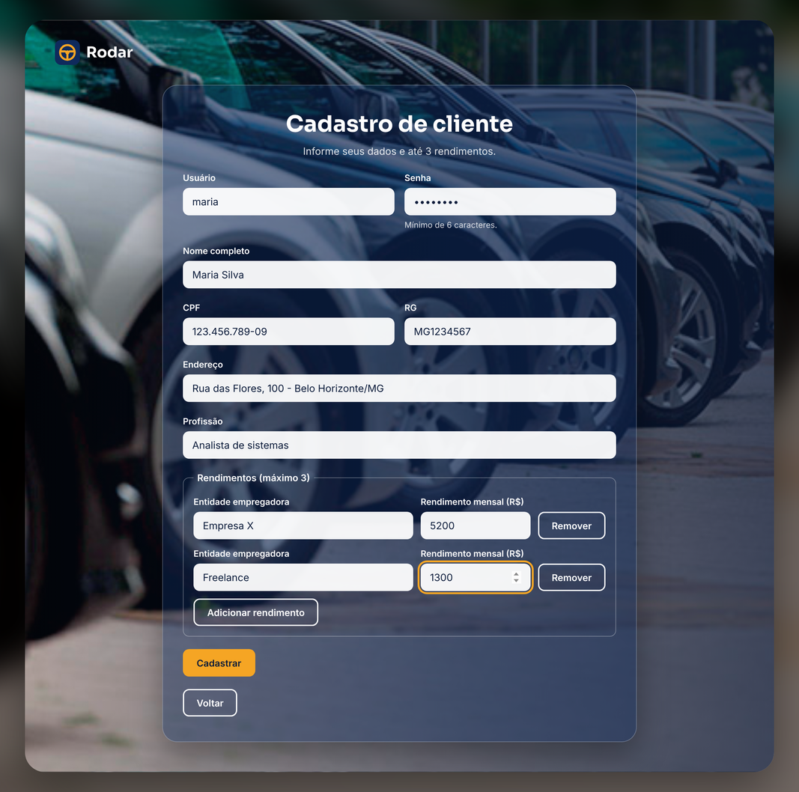 | 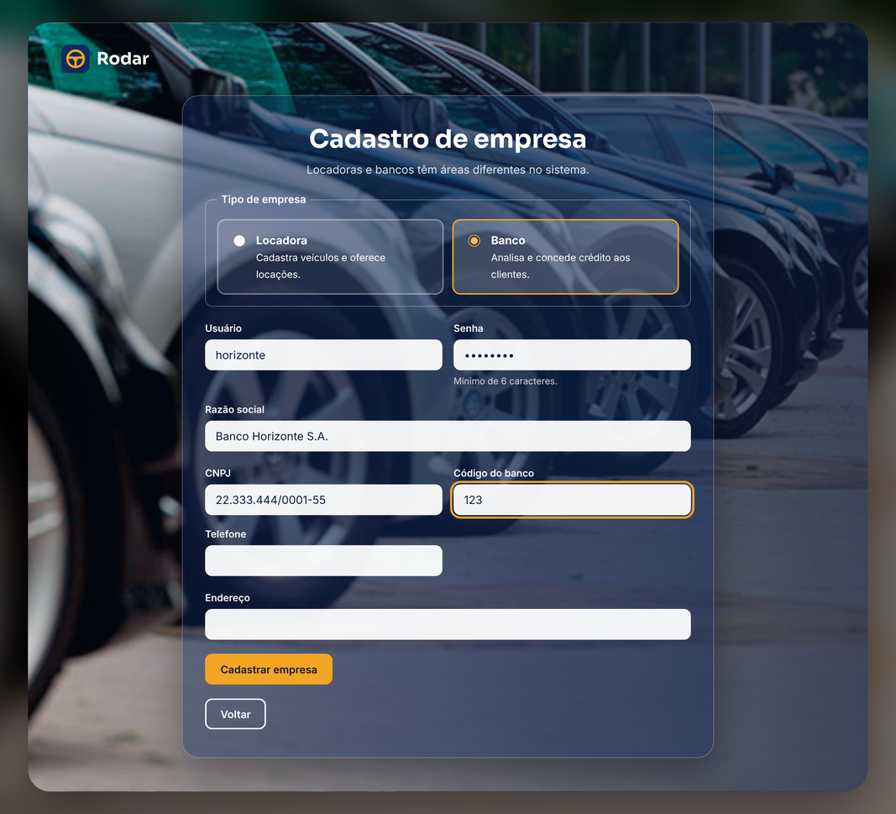 |
| **Cliente: nova locação** | **Cliente: minhas locações** |
| 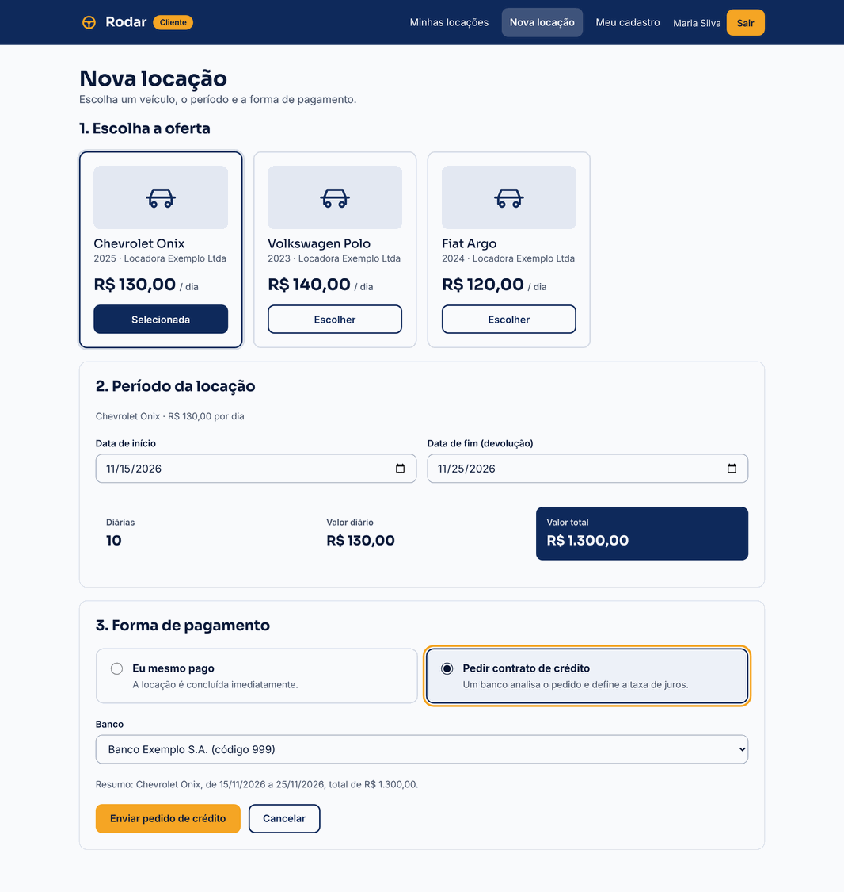 | 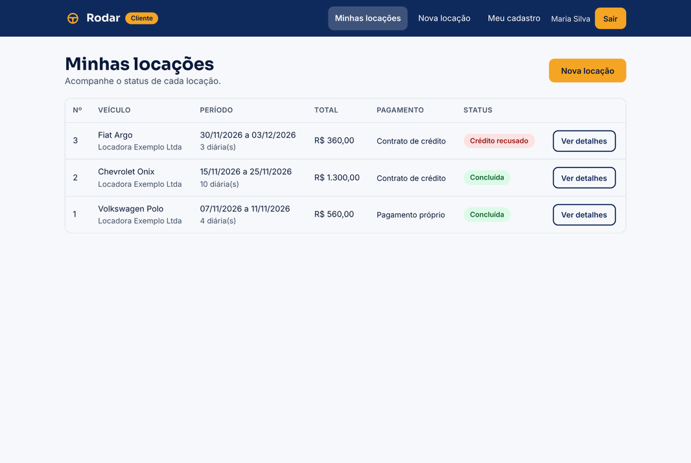 |
| **Cliente: crédito recusado** | **Locadora: ofertas de locação** |
| 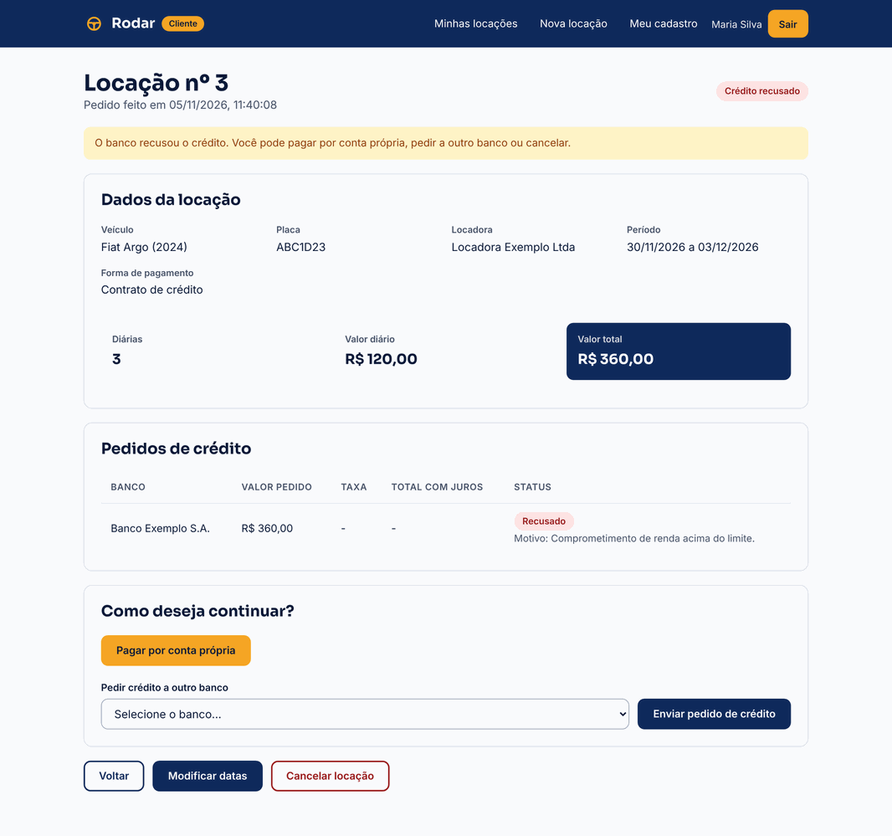 | 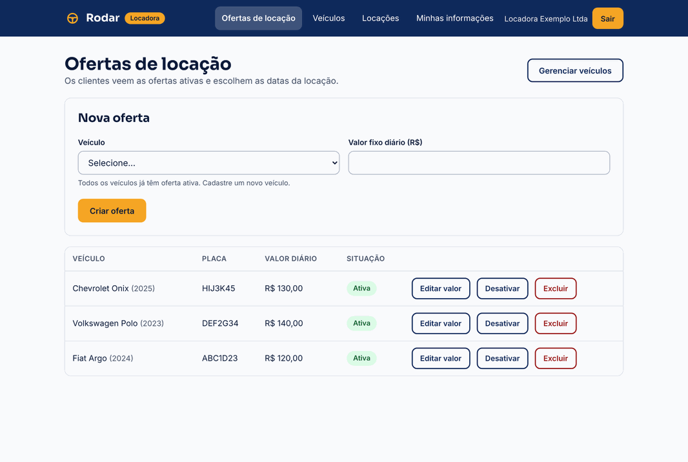 |
| **Banco: pedidos de crédito** | **Banco: análise com taxa diária** |
| 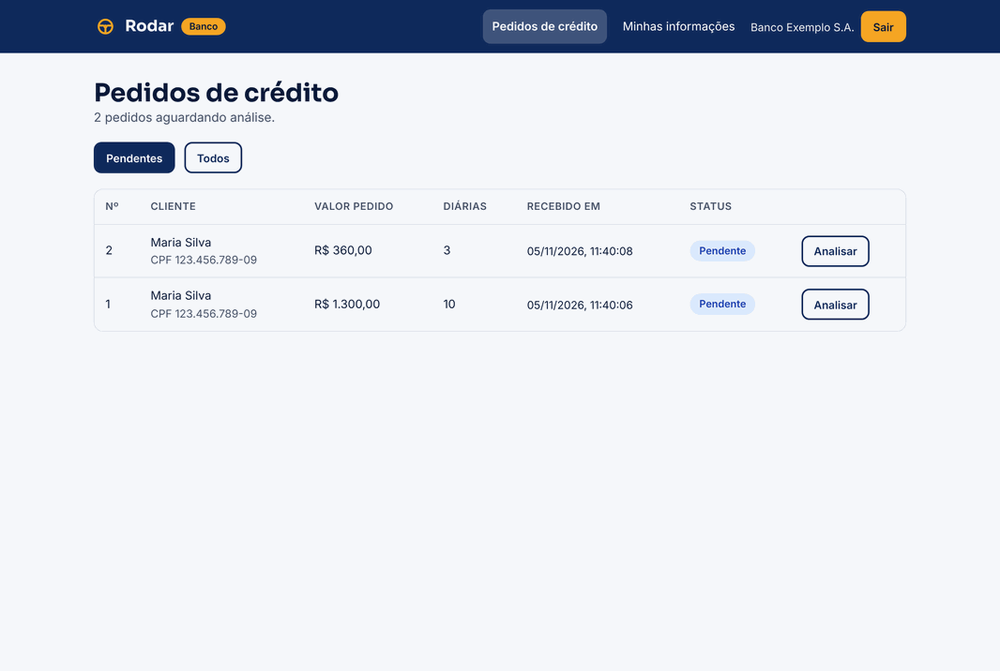 | 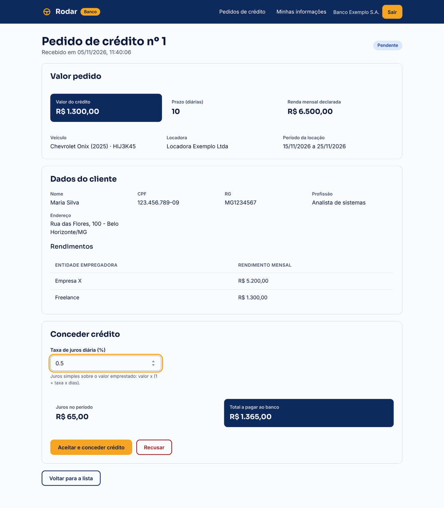 |

### 💻 Exemplo de uso da API (cURL)

```bash
# Login (público)
curl -s -X POST http://localhost:8080/api/auth/login \
     -H 'Content-Type: application/json' \
     -d '{"login":"banco","senha":"Banco@123"}'

# Pedidos de crédito do banco logado
curl -s http://localhost:8080/api/creditos -H 'Authorization: Bearer <token>'

# Conceder crédito com 0,5% de juros ao dia
curl -s -X POST http://localhost:8080/api/creditos/1/aprovacao \
     -H 'Authorization: Bearer <token>' -H 'Content-Type: application/json' \
     -d '{"taxaJurosDiaria":0.5}'
```

**Saída esperada (resumo):**
```json
{
  "id": 1,
  "status": "APROVADO",
  "valorSolicitado": 700.00,
  "quantidadeDias": 5,
  "taxaJurosDiaria": 0.5,
  "valorTotalComJuros": 717.50,
  "bancoNome": "Banco Exemplo S.A."
}
```

<details>
<summary><b>Endpoints da API</b></summary>

| Método | Rota | Perfil | Descrição |
| :--- | :--- | :--- | :--- |
| POST | `/api/auth/login` | público | Login (retorna o token JWT) |
| POST | `/api/clientes` | público | Cadastro de cliente |
| GET / PUT / DELETE | `/api/clientes/{id}` | cliente (próprio) | Consultar, alterar, excluir |
| POST | `/api/agentes` | público | Cadastro de empresa (locadora ou banco) |
| GET / PUT | `/api/agentes/me` | locadora, banco | Minhas informações |
| GET | `/api/bancos` | logado | Lista de bancos |
| GET / POST / PUT / DELETE | `/api/automoveis[/{id}]` | locadora | Veículos da locadora |
| GET | `/api/ofertas` | cliente, locadora | Cliente: ofertas ativas · Locadora: as suas |
| POST / PUT / DELETE | `/api/ofertas[/{id}]` | locadora | Gerenciar ofertas |
| POST | `/api/pedidos` | cliente | Solicitar locação (`PROPRIO` ou `CREDITO` + `bancoId`) |
| GET | `/api/pedidos[/{id}]` | cliente, locadora | Locações |
| PUT | `/api/pedidos/{id}` | cliente | Modificar datas |
| POST | `/api/pedidos/{id}/cancelamento` | cliente | Cancelar |
| POST | `/api/pedidos/{id}/pagamento-proprio` | cliente | Pagar por conta própria após recusa |
| POST | `/api/pedidos/{id}/solicitacao-credito` | cliente | Pedir a outro banco após recusa |
| GET | `/api/creditos[/{id}]` | banco | Pedidos de crédito recebidos |
| POST | `/api/creditos/{id}/aprovacao` | banco | Conceder (com `taxaJurosDiaria`) |
| POST | `/api/creditos/{id}/recusa` | banco | Recusar (com `motivo` opcional) |

</details>

---

## 🔗 Documentação Utilizada

* 📖 **Front-end:** [Documentação oficial do **React**](https://react.dev/reference/react)
* 📖 **Build:** [Guia de configuração do **Vite**](https://vitejs.dev/config/)
* 📖 **Back-end:** [Documentação oficial do **Spring Boot**](https://docs.spring.io/spring-boot/index.html)
* 📖 **Segurança:** [**Spring Security**: OAuth2 Resource Server (JWT)](https://docs.spring.io/spring-security/reference/servlet/oauth2/resource-server/jwt.html)
* 📖 **Banco de dados:** [Conexão com o **Supabase**](https://supabase.com/docs/guides/database/connecting-to-postgres)

---

## 👥 Autores

| 👤 Nome | GitHub | 💼 LinkedIn | 📤 Gmail |
|---------|-----------------|-------------|-----------|
| Paulo César Silva Monteiro | PauloCesar0709 | https://www.linkedin.com/in/paulo-c%C3%A9sar-desenvolvedor/ | paulocsm2006@gmail.com

---

## 🙏 Agradecimentos

* [**Engenharia de Software PUC Minas**](https://www.instagram.com/engsoftwarepucminas/) - Pelo apoio institucional e pela estrutura acadêmica.
* [**Prof. Dr. João Paulo Aramuni**](https://github.com/joaopauloaramuni) - Pelos ensinamentos de **Arquitetura de Software** e **Padrões de Projeto**

---

## 📄 Licença

Este projeto é distribuído sob a **[Licença MIT](LICENSE)**.

---

